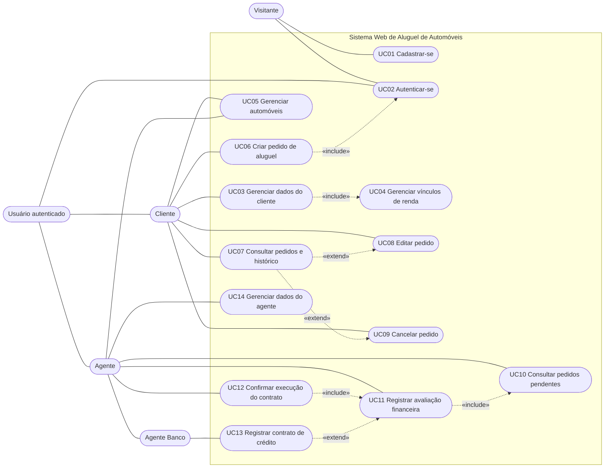

# Sprint 1 — Diagrama de Casos de Uso

Sistema Web de Aluguel de Automóveis

## 1. Atores

| Ator | Descrição |
|------|-----------|
| **Visitante** | Pessoa ainda não autenticada. Só pode se cadastrar ou fazer login. |
| **Usuário** | Ator abstrato. Qualquer pessoa autenticada (Cliente ou Agente). |
| **Cliente** | Pessoa física que solicita aluguéis e gerencia seus próprios pedidos. |
| **Agente** | Empresa ou Banco. Analisa financeiramente os pedidos e altera seu status. |
| **Agente (Banco)** | Especialização de Agente. Único que pode conceder contrato de crédito. |

## 2. Diagrama

> Linhas contínuas: associação ator–caso de uso. Linhas tracejadas: relacionamentos entre casos de uso.

## 3. Catálogo de casos de uso

| ID | Caso de uso | Ator principal | Resumo |
|----|-------------|----------------|--------|
| UC01 | Cadastrar-se | Visitante | Cria conta como Cliente (nome, CPF, RG, endereço, profissão) ou como Agente (nome, CNPJ, endereço, tipo). O perfil define as permissões. |
| UC02 | Autenticar-se | Visitante / Usuário | Login obrigatório para qualquer operação. Redireciona conforme o perfil. |
| UC03 | Gerenciar dados do cliente | Cliente | Consultar, editar e excluir o próprio cadastro. |
| UC04 | Gerenciar vínculos de renda | Cliente | Incluir, editar e remover entidades empregadoras com rendimento. **Máximo de 3.** |
| UC05 | Gerenciar automóveis | Cliente / Agente | Cadastrar, consultar, editar e excluir automóveis. Proprietário obrigatório (cliente, empresa ou banco). |
| UC06 | Criar pedido de aluguel | Cliente | Seleciona automóvel e período. Pedido nasce com status *Em análise*. |
| UC07 | Consultar pedidos e histórico | Cliente | Lista apenas os próprios pedidos, com status atual e histórico de mudanças. |
| UC08 | Editar pedido | Cliente | Altera dados do próprio pedido enquanto estiver *Em análise*. |
| UC09 | Cancelar pedido | Cliente | Muda o status para *Cancelado*. Pedido cancelado não pode ser aprovado nem executado. |
| UC10 | Consultar pedidos pendentes | Agente | Lista pedidos *Em análise*. |
| UC11 | Registrar avaliação financeira | Agente | Registra agente, data, parecer (aprovado/reprovado) e justificativa. Atualiza o status do pedido. |
| UC12 | Confirmar execução do contrato | Agente | Move pedido *Aprovado* para *Contrato em execução*. |
| UC13 | Registrar contrato de crédito | Agente Banco | Opcional. Associa ao pedido valor financiado, prazo e situação do crédito. |
| UC14 | Gerenciar dados do agente | Agente | Consultar e editar dados do agente (nome, CNPJ, endereço, tipo). |

## 4. Regras de negócio associadas

| ID | Regra | Casos de uso |
|----|-------|--------------|
| RN01 | Apenas usuários cadastrados e autenticados usam o sistema. | UC02 |
| RN02 | Cliente só cria, edita, consulta e cancela os **seus** pedidos. | UC06–UC09 |
| RN03 | Pedido cancelado não pode ser aprovado nem colocado em execução. | UC11, UC12 |
| RN04 | Apenas Agentes realizam avaliações financeiras, e a avaliação registra o agente. | UC11 |
| RN05 | Cliente tem no máximo 3 vínculos empregatícios/rendimentos. | UC04 |
| RN06 | Contrato de crédito só pode ser concedido por Agente do tipo Banco. | UC13 |
| RN07 | Todo automóvel tem proprietário identificado (cliente, empresa ou banco). | UC05 |

## 5. Premissas adotadas

1. Não há painel administrativo (item opcional no enunciado).
2. Agentes se cadastram pelo próprio fluxo de UC01, escolhendo o tipo (Empresa ou Banco).
3. Clientes cadastram automóveis de sua propriedade. Agentes cadastram automóveis da empresa ou do banco.
4. Um pedido só pode ser editado enquanto estiver *Em análise*.
5. Qualquer agente pode avaliar um pedido pendente. O agente que avalia passa a ser o agente responsável pelo pedido.
