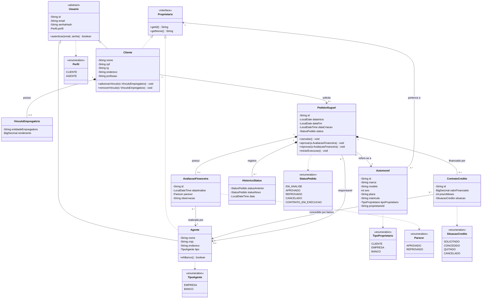
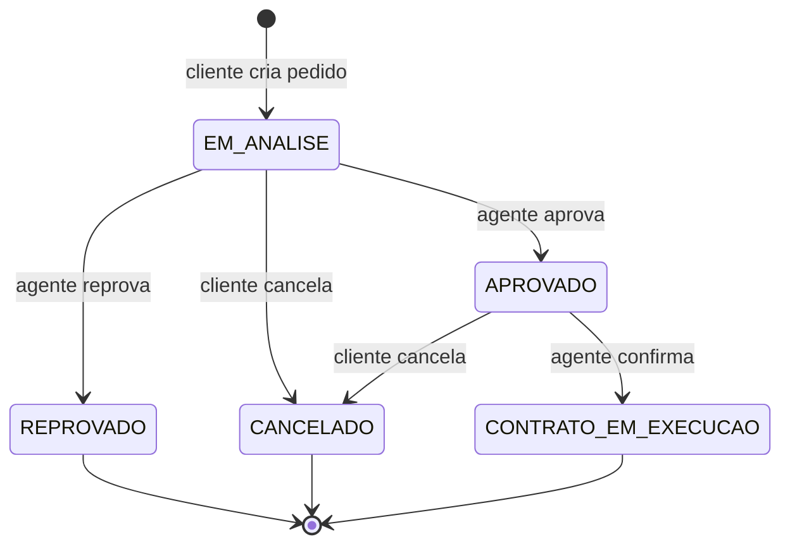

# Sprint 1 — Diagrama de Classes

Sistema Web de Aluguel de Automóveis

## 1. Diagrama

## 2. Dicionário de classes

| Classe | Responsabilidade |
|--------|------------------|
| **Usuario** | Classe abstrata com credenciais e perfil. Base do controle de acesso. |
| **Cliente** | Pessoa física. Armazena nome, CPF, RG, endereço, profissão e seus vínculos de renda. |
| **VinculoEmpregaticio** | Entidade empregadora e rendimento associado. Composição de Cliente, máximo de 3. |
| **Agente** | Empresa ou Banco que avalia pedidos. O tipo é definido por `TipoAgente`. |
| **Proprietario** | Interface que permite a Cliente e Agente (empresa ou banco) serem donos de automóveis. |
| **Automovel** | Veículo com marca, modelo, ano, placa, matrícula e proprietário obrigatório. |
| **PedidoAluguel** | Solicitação do cliente. Concentra status, período e a transição de estados. |
| **AvaliacaoFinanceira** | Parecer do agente com data e justificativa. |
| **ContratoCredito** | Financiamento opcional do pedido, concedido por agente do tipo banco. |
| **HistoricoStatus** | Registro de cada mudança de status, usado na consulta de histórico (UC07). |

## 3. Restrições (OCL em linguagem natural)

| ID | Restrição |
|----|-----------|
| R1 | `Cliente.vinculos.size() <= 3` |
| R2 | `ContratoCredito.banco.tipo = BANCO` |
| R3 | `Automovel.proprietarioId` é obrigatório e deve existir conforme `tipoProprietario`. |
| R4 | `AvaliacaoFinanceira.agente` é obrigatório, e só `Perfil.AGENTE` avalia. |
| R5 | Pedido com status `CANCELADO` não pode ser aprovado nem ir para `CONTRATO_EM_EXECUCAO`. |
| R6 | Um cliente só acessa pedidos em que `pedido.cliente = clienteLogado`. |
| R7 | `PedidoAluguel.dataFim > dataInicio`. |
| R8 | `ContratoCredito` só existe para pedido `APROVADO` ou `CONTRATO_EM_EXECUCAO`. |
| R9 | `Agente.tipo = BANCO` ou `EMPRESA`, e o CNPJ é único. |

## 4. Máquina de estados do pedido

| De | Para | Quem | Condição |
|----|------|------|----------|
| (novo) | Em análise | Cliente | Dados válidos |
| Em análise | Aprovado | Agente | Avaliação com parecer aprovado |
| Em análise | Reprovado | Agente | Avaliação com parecer reprovado e justificativa |
| Em análise / Aprovado | Cancelado | Cliente | Dono do pedido |
| Aprovado | Contrato em execução | Agente | Pedido não cancelado |

## 5. Mapeamento para MongoDB

| Coleção | Conteúdo | Observação |
|---------|----------|------------|
| `usuarios` | Cliente e Agente (campo `perfil`) | Os vínculos de renda ficam **embutidos** no documento do cliente (máx. 3). |
| `automoveis` | Automóvel com `tipoProprietario` e `proprietarioId` | Referência ao `usuarios._id`. |
| `pedidos` | Pedido com `clienteId`, `automovelId`, `agenteId` | Avaliação, contrato de crédito e histórico de status **embutidos**. |

## 6. Decisões de modelagem

1. **Herança Usuario → Cliente / Agente:** os dois perfis compartilham autenticação e acesso.
2. **Agente com enum `TipoAgente`** em vez de subclasses Empresa e Banco: o comportamento é o mesmo, e a diferença (apenas banco concede crédito) é uma regra validada em R2.
3. **Interface Proprietario:** permite que o automóvel pertença a cliente, empresa ou banco sem duplicar classes.
4. **AvaliacaoFinanceira e ContratoCredito como composição** do pedido: não existem sem ele.
5. **HistoricoStatus** atende ao requisito de consulta de histórico dos pedidos.
