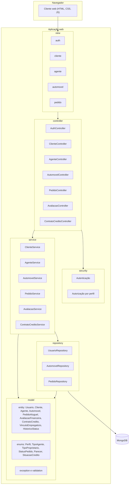

# Sprint 1 — Diagrama de Pacotes

Sistema Web de Aluguel de Automóveis. Visão lógica inicial (arquitetura MVC com camada de serviço).

## 1. Diagrama



## 2. Descrição dos pacotes

| Pacote | Camada MVC | Responsabilidade | Depende de |
|--------|-----------|------------------|-----------|
| `view` | **View** | Telas e templates: login, cadastros, lista e detalhe de pedidos, painel do agente. | `controller` |
| `controller` | **Controller** | Recebe requisições HTTP, valida entrada, chama os serviços e escolhe a view. Não contém regra de negócio. | `service`, `security` |
| `security` | Transversal | Autenticação, sessão/token e verificação de perfil (Cliente ou Agente) em cada rota. | `model`, `repository` |
| `service` | **Model** (lógica) | Regras de negócio: limite de 3 vínculos, transições de status, contrato só por banco, cliente só acessa seus pedidos. | `model`, `repository` |
| `model` | **Model** (domínio) | Entidades, enums, exceções de domínio e validações. Não depende de nenhum outro pacote. | nenhum |
| `repository` | **Model** (persistência) | Acesso ao MongoDB: consultas, gravação e mapeamento de documentos. | `model`, MongoDB |

## 3. Regras de dependência

1. As setas seguem uma direção só: **view → controller → service → repository → model**. Não há dependência no sentido contrário.
2. O `model` é o núcleo e não conhece frameworks nem banco de dados.
3. Controllers nunca acessam repositórios diretamente. Passam sempre por um serviço.
4. Toda regra de negócio fica no `service` (ou nas entidades), nunca na view ou no controller.
5. A autorização por perfil é aplicada no `controller` via `security`, e as regras de posse (R6) são conferidas também no `service`.

## 4. Mapeamento por tecnologia

A estrutura lógica é a mesma, mudam apenas os nomes físicos.

| Pacote lógico | Java (Spring Boot) | Node.js (Express) |
|---------------|--------------------|-------------------|
| `view` | `src/main/resources/templates` | `src/views` |
| `controller` | `com.aluguel.controller` | `src/controllers` |
| `security` | `com.aluguel.security` | `src/middlewares` |
| `service` | `com.aluguel.service` | `src/services` |
| `model` | `com.aluguel.model` | `src/models` |
| `repository` | `com.aluguel.repository` | `src/repositories` |

## 5. Estrutura sugerida do repositório

```
projeto-aluguel/
├── README.md              
├── docs/
│   └── uml/
│       ├── 01-diagrama-casos-de-uso.md
│       ├── 02-historias-de-usuario.md
│       ├── 03-diagrama-de-classes.md
│       └── 04-diagrama-de-pacotes.md
└── src/
    ├── controller/
    ├── service/
    ├── model/
    ├── repository/
    ├── security/
    └── view/
```

## 6. Rastreabilidade

| Pacote | Casos de uso atendidos |
|--------|------------------------|
| `controller` / `view` / `service` | UC01 a UC14 |
| `security` | UC01, UC02 (RN01) e controle de perfil de todos os casos |
| `model` | Classes do diagrama de classes (entrega 3) |
| `repository` | Persistência de `usuarios`, `automoveis` e `pedidos` |
